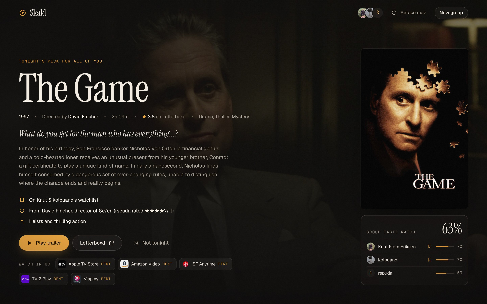
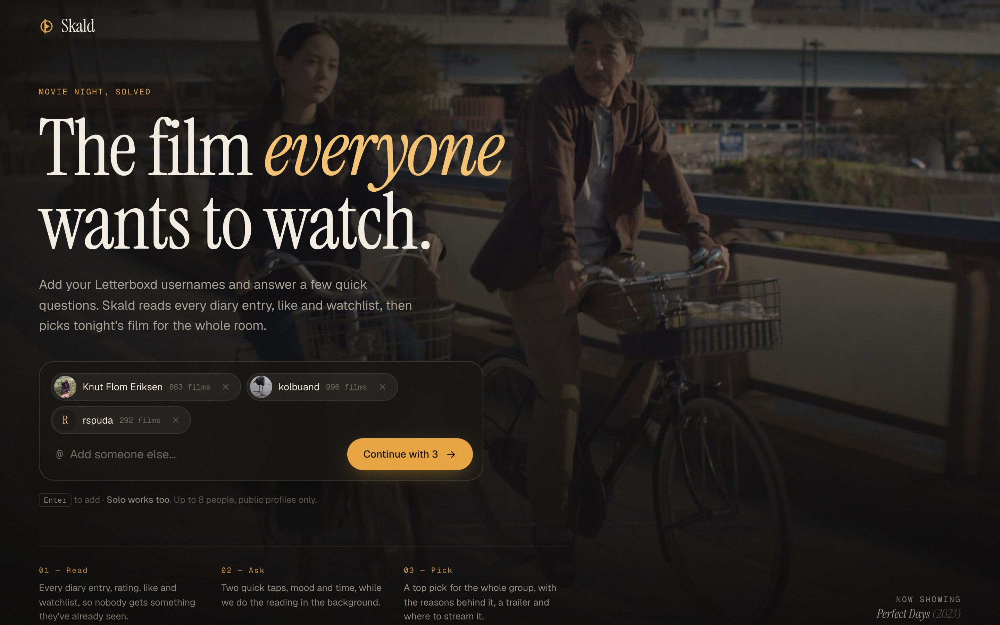
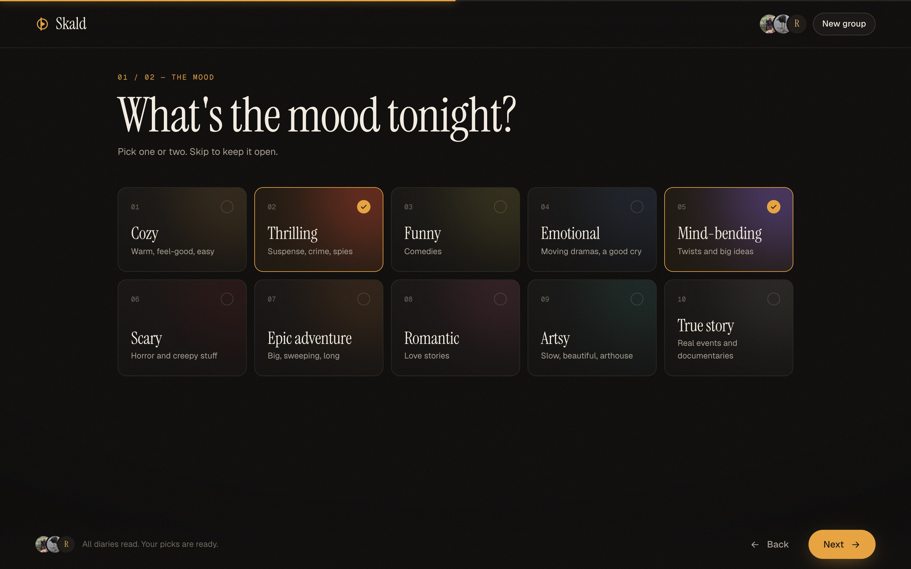
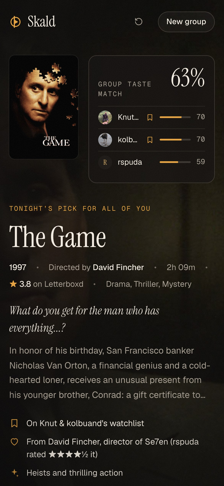

# Skald

**The film everyone wants to watch.** Add one or more Letterboxd usernames, pick a mood and how much time you have, and Skald picks tonight's film. It knows what everyone has already seen, what they loved, and what's been sitting on their watchlists.



<table>
  <tr>
    <td width="50%"></td>
    <td width="50%"></td>
  </tr>
  <tr>
    <td align="center"><sub>Add everyone's Letterboxd username</sub></td>
    <td align="center"><sub>Pick a mood while it reads everyone's films</sub></td>
  </tr>
</table>

<p align="center"></p>

## Run it

```bash
git clone https://github.com/Knut-Eriksen/Skald.git
cd Skald
python3 run.py
```

That's it. The first run creates a virtualenv, installs the Python packages, builds the interface (needs Node.js 18+) and opens http://localhost:8000.

Optional: copy `.env.example` to `.env` and add a free [TMDB](https://www.themoviedb.org/settings/api) key for extra discovery.

## How it works

1. **Read.** As soon as you press Continue, the backend starts reading every member's diary (ratings), likes and watchlist straight from Letterboxd while you answer the questions.
2. **Learn taste.** Ratings are read against each person's own habits: 3.5★ from a generous rater is a shrug, from a harsh one it's a rave. Each person's standout favourites (recent first) and their real letdowns build a weighted profile of genres, Letterboxd themes, directors, cast, countries and decades. The profile is *centred* on what a typical film has, so "English-language drama" doesn't count as taste just because most films are one, and what's left is the real signal (Villeneuve, anime, war epics).
3. **Gather candidates.**
   - *Watchlists:* everything on anyone's watchlist that nobody has seen. Films on several watchlists come first.
   - *New finds:* Letterboxd's "similar films" for everyone's favourites, starting with the favourites the group *shares*, ranked by how many favourites (and people) point at them. TV series aren't followed. With a TMDB key, TMDB recommendations are added too.
   - *Vibe charts:* once you pick a mood (and era), the matching Letterboxd genre charts are fetched in the background, so "Epic adventure" can surface epics even for a group of drama fans.
   - Other versions of films someone has seen (a TV remake, a re-cut) are left out.
4. **Score.** Every film gets a closeness score per person on one shared scale (1 = as strong a fit as their best options tonight). A film on your own watchlist counts as at least halfway there, since you saved it for a reason. Group taste is half the average and half the *least* happy member, so nobody gets stuck with something they'd sit through politely. Then: Letterboxd rating (saturating at 4.0, because past that "for us" beats "acclaimed"), watchlist overlap, a steep mood fit (a mood is a request, not a nudge), and crowd-pleaser vs hidden-gem fit. Runtime, era, subtitles and animation filter the list, and a director-diversity pass stops one filmmaker from taking over.
5. **Explain.** Every pick says *why*, in first names: who has it on their watchlist, which loved film it connects to ("From Park Chan-wook, director of Oldboy (Knut rated ★★★★★ it)"), and which theme matches the mood. Weak links (a voice role, a TV episode, two vague shared themes) are left out instead of padded in.

Results come with the trailer, streaming/rent options for your country (via Letterboxd/JustWatch), a per-person match score, an **Adjust the vibe** drawer that re-ranks instantly, and a **Streaming now** filter that hides anything you'd have to rent.

## Notes

- Profiles must be public. Private watchlists are simply skipped.
- Everything is cached in `cache.sqlite3` (user data for 6 h, film details for 30 days), so the second run for the same group is instant. Delete the file to start fresh.
- First run for a big profile (3–5k films) takes ~20–40 s, mostly hidden behind the questions.
- Keyboard: `1`–`9`/`0` pick answers, `Enter` next, `←` back; on results `T` plays the trailer, `N` skips.

## Development

```bash
.venv/bin/python -m uvicorn backend.app:app --reload  # API on :8000
cd frontend && npm run dev                       # UI on :5173 (proxies /api)
.venv/bin/python -m backend.test_recommend       # recommender self-check
node docs/screenshots.mjs http://localhost:8000  # retake the README screenshots
```

```
backend/
  letterboxd.py   scraping (curl_cffi impersonates Chrome to get past Cloudflare)
  recommend.py    pure scoring + explanations
  engine.py       background data gathering with progress events
  app.py          FastAPI: REST + server-sent events, serves the built UI
  tmdb.py         optional extra discovery
frontend/         Vite + React + TypeScript + Motion
run.py            one-command launcher
```

This scrapes public Letterboxd pages for personal use. Be gentle (requests are rate-limited and cached).
